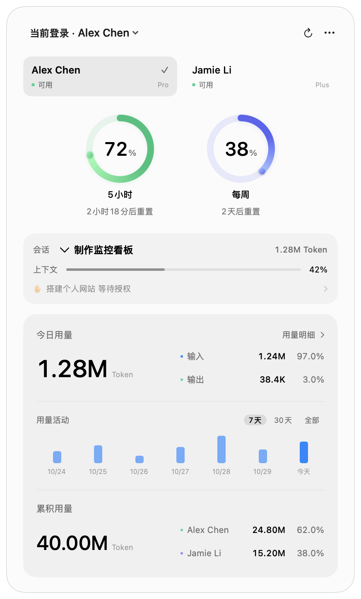

# Codex Eyes

原生 macOS Codex 用量看板。使用真实账号昵称查看额度、重置倒计时、本机任务和 Token 统计；账号状态始终可见。



## 下载应用

前往 [GitHub Releases](https://github.com/doublegou/codex-eyes/releases)，下载最新的 `universal-preview.dmg`，
打开后将 **Codex Eyes.app** 拖入“应用程序”，再从“应用程序”启动。菜单栏圆环是常驻入口。
通用包包含 Apple Silicon 和 Intel 版本，用户无需安装 Node.js、Python 或 Xcode。

当前仓库为私有，下载需要对应 GitHub 访问权限。当前安装包使用本地签名，尚未经过 Apple 公证，
浏览器下载后的首次启动可能受到系统验证限制。`preview` 只表示发行状态，应用正常读取真实数据。
本工具用于已经安装并登录 Codex 的 Mac；官方账号累计与每日活动依赖兼容版本的 Codex CLI。

## 功能

- 多账号卡片、真实昵称、备注与排序、各账号可用状态及恢复倒计时。
- 短期／每周额度、恢复倒计时、缓存和登录异常提示。
- 独立的真实账号切换入口，默认关闭；查看账号不会切换登录。
- 本机会话的最近上下文记录、Token 明细、压缩次数、今日统计和可切换范围的用量热力图。
- 官方账号累计 Token、账号占比、每日活动和单日最高用量；账号图表通过单个按钮切换最近30条柱状图与全部记录热力图，悬停浮层显示对应日期和 Token。
- 可选的任务生命周期 Hooks 和去重通知。
- Liquid Glass、深浅色、隐私模式、开机启动、悬浮窗。

**状态区分：**“当前配置”只表示账号工具记录的本地配置，不代表已经核验运行中的客户端身份。本轮结束不代表整个任务完成；本机日志统计不归属于当前查看的账号。

## 本地构建

需要 macOS 14+、Xcode 26+（含 macOS 26+ SDK）、Python 3（仅构建时）。App 本身不依赖 Node.js 或 Python。官方账号统计还需要可用的官方 Codex CLI（须支持 account/usage/read）；程序会检测 ChatGPT / Codex App 内置路径及常见安装路径。

```sh
bash scripts/test.sh
python3 scripts/test-account-import.py # 下载固定辅助程序后可运行的离线导入检查
bash scripts/package.sh arm64
open 'dist/Codex Eyes.app' --args --show
```

Intel 使用 `bash scripts/package.sh x86_64`；通用包使用 `bash scripts/package.sh universal`。依赖下载检查固定 SHA-512；辅助程序固定为 codex-auth 0.3.1，不自动追踪上游主分支。

开发时可以 `python3 scripts/vendor.py` 后 `swift run CodexEyes --show`。打包后的 App 才支持开机启动和完整 Hooks 路径。

正常启动始终加载真实账号和本机日志，不恢复旧版本保存的演示模式。开发者可显式传 `--demo` 或 `--render-preview` 使用合成数据进行布局验证；该模式不保存在偏好中，公开使用界面不提供演示开关。README 中的预览图片使用合成数据，真实账号画面不提交仓库。

## 使用

菜单栏用单个进度圆环显示当前配置账号的剩余百分比，优先取 5 小时窗口，没有时取每周窗口；无有效数据时显示横线。点击圆环，或按 **⌘⇧E** 展开。切换查看不改变菜单栏对应账号。面板顶部的账号卡片显示真实昵称、套餐和状态；点击卡片只切换查看，重新展开会回到当前登录配置的账号。可用状态依据最新查询判断，额度用尽时显示如 `2小时15分后可用`；未知或过期数据不标为可用。左上角以“当前登录 · 昵称”显示当前登录配置；点击整个账号入口可切换登录。菜单左侧圆点复用面板的账号状态颜色，当前登录账号的勾选标记位于名称右侧。首次使用需在账号设置启用入口；每次切换均检查相关客户端和后台进程是否退出。确认框可勾选“不再提醒”，仅省略之后的确认，不省略退出检查。

面板按服务端实际提供的窗口显示额度，界面采用“5小时／每周”等中文标签；仅提供每周额度的套餐只显示周额度环。重置时间采用“2小时15分后重置”等中文倒计时。当前会话从本地标题索引读取真实聊天名称，例如“codex监控规划”是聊天标题，不是功能名。Token 看板按“本机今日用量 → 本机用量活动 → 累积用量”排列，保留今日总量的主要数字样式。账号累计汇总所列账号的官方 lifetimeTokens，并展示每个账号的数量和占比，包含其在其他设备上的用量；缺少某个账号数据时只显示已知小计及 ≥，不计算占比。查询失败保留缓存并标记，未提供字段不当作零。今日右侧改为本机当天的输入／输出数量和占比，缓存包含在输入中、推理包含在输出中，不重复累加；明细不完整时不显示猜测比例。本机日志不做历史账号归属推断。用量活动右侧可切换 7天、30天、全部；7天使用系统蓝柱状图，30天和全部使用热力图；全部覆盖本机已记录历史，长历史自动按周、月或年合并，悬停显示日期范围和 Token，图表高度固定。“用量明细 >”位于统计卡片右上角。仅供开发的合成预览展示有已确认分项时的布局。账号与额度始终固定显示，输入、缓存输入、输出、推理输出及会话排行在独立的“用量明细”窗口查看。右上角更多菜单提供设置、固定和退出。

macOS 26+ 使用原生 NSGlassEffectView Liquid Glass；旧版系统使用原生 popover 回退。玻璃四周保留透明溢出区，关闭额外的窗口阴影，避免切边与黑色外框。显示效果遵循系统外观和辅助功能设置。

设置和明细采用原生 NavigationSplitView 侧边栏与统一工具栏。设置分为账号、通用、通知，使用系统分组表单；账号操作保留原有确认及退出条件。明细在侧边栏直接选择用量总览、本机会话或各个账号，使用 Swift Charts 展示活动，日期列表可折叠，保留全部已返回的服务端记录。两个辅助窗口均可调整大小，主面板随内容自适应高度。

通用页提供“语言”（跟随系统、简体中文、English）与“外观”（跟随系统、浅色、深色），选择即时应用到主面板、设置及明细，不改变 Mac 的系统设置。新安装默认跟随系统；旧版升级保留中文。系统语言不是中文时使用英文界面。展开看板快捷键可点击录入，需包含 ⌘ 或 ⌃；冲突、无效组合不覆盖原快捷键，旁边按钮恢复默认 ⌘⇧E。录入期间暂时停用原快捷键，退出录入后恢复注册。

账号页顶部提供登录切换开关和说明；当前登录标记位于昵称旁，账号右上角用独立的系统箭头按钮调整顺序。添加账号只显示登录说明：在现有客户端完成 Codex 登录后，工具监听实际 CODEX_HOME/auth.json 的变化，自动将当前登录同步进列表，保留已保存账号。没有“开始登录”或“重新检查”步骤；监听之外每15秒检查一次文件状态，繁忙时延后同步。这里只识别本机 Codex 登录，不读取普通 ChatGPT 网页的登录 Cookie。设置中也可修改备注和移除账号。真实账号切换入口默认关闭。开启后，先完全退出 ChatGPT / Codex 及相关后台进程，再从面板左上角或账号行选择“切换登录”。程序不会结束你的任务或自动重启客户端；查看／刷新不执行切换命令。

任务状态需要在设置中手动连接 Hooks，然后在 Codex 的 `/hooks` 中检查、信任对应定义，并运行一轮任务。配置存在不代表已经信任。移动 App 或更新后如定义变化，需要重新连接并审查。卸载前先断开 Hooks。

通知默认关闭。通知页顶部显示系统授权状态，右侧可申请通知权限或打开对应的系统通知设置；返回 App 时重新读取状态。下方独立选择提醒分类，任务连接说明放在任务开关下方。全局快捷键如与其他软件冲突，可使用菜单栏入口。

## 数据和隐私

- 账号凭据由 codex-auth 管理，沿用实际 `CODEX_HOME`，默认 `~/.codex`。App 从本地登录快照的身份字段读取真实昵称，只缓存昵称。官方账号统计会创建 0700 的独立临时目录，用 0600 的只读凭据副本调用 App Server；副本清空刷新令牌，查询后清理，不持久缓存令牌或切换原登录。
- 账号额度由内置 codex-auth 查询，它使用 OpenAI 服务的 usage/account 接口；这些服务接口存在兼容变化的可能。App 不发送生成请求探测额度，也不连接第三方业务服务器。
- 官方账号活动通过独立 App Server 的 account/usage/read 读取，统计缓存与额度缓存分开；每日服务端记录可能延迟，不按 Mac 时区重新分桶。
- 自有偏好位于 UserDefaults；缓存、索引和最小事件记录位于 `~/Library/Application Support/CodexEyes/`。
- 日志索引仅保存本地文件位置、会话标识、项目末级目录名、模型、用量和时间，不缓存聊天正文。权限为目录 0700、文件 0600。
- 隐私模式隐藏邮箱和项目名称；自定义备注应自行避免使用敏感信息。通知、诊断和演示素材不输出凭据。
- 查询失败保留旧值但标明缓存；十分钟未成功确认后不显示绿色可用状态。
- 命令行辅助程序会使用 Mac 已启用的显式 HTTP／HTTPS／SOCKS 系统代理，既有代理环境变量优先；不修改系统网络设置。

## 发布

默认打包为本地 ad-hoc 签名，**不等于 Developer ID 签名或已公证发行版**。

提供完整 `.app` 和可拖入“应用程序”的 `.dmg`。普通构建产物带 `-preview` 后缀；这是发行状态，正常运行仍使用真实数据。
应用图标来自项目所有者提供的图片，权利说明见 [图标声明](Assets/NOTICE.md)，公开版需要处理其中 OpenAI 标志的授权或替换。

公开发行时配置 `CODEX_EYES_SIGN_IDENTITY` 为 Developer ID Application identity，并用 `xcrun notarytool store-credentials` 创建本机公证配置；将其名称设为 `CODEX_EYES_NOTARY_PROFILE`，运行 `bash scripts/package.sh universal --release`。脚本会签名嵌套可执行文件、公证应用和 DMG、附加票据并进行 Gatekeeper 检查。具体见 [公开发行流程](docs/releasing.md)。

本版不包含更新框架，也不自动检查、下载或安装新版本。版本号显示在通用设置最下方；新版本可由发布者提供 GitHub 安装包。

详细说明见 [兼容性](docs/compatibility.md)、[验证记录](docs/validation.md)、[架构](docs/architecture.md)。源码采用 MIT，内置辅助程序的声明见 [ThirdParty/NOTICE.md](ThirdParty/NOTICE.md)。

账号累计与本机归属的官方接口验证见 [调研记录](docs/research-account-usage.md)。账号累计与每日活动现已接入；本机历史账号归属仍待可靠数据源。
