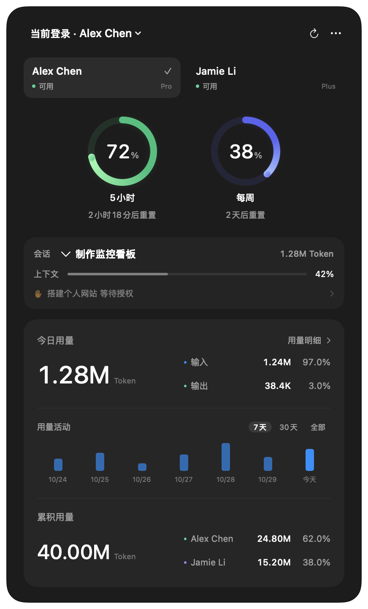

  

<h1 align="center">Codex Eyes</h1>

在 Mac 菜单栏，查看 Codex 额度与用量。

  <a href="https://github.com/doublegou/codex-eyes/releases"><strong>下载 macOS 应用</strong></a>
  · <a href="#安装">安装说明</a>
  · <a href="https://github.com/doublegou/codex-eyes/issues">反馈问题</a>

macOS 14+ · Apple Silicon / Intel · 简体中文 / English

  
  &nbsp;
  

## 功能

- **剩余额度** — 查看 5 小时与每周额度、重置时间，菜单栏圆环显示当前登录账号的剩余比例。
- **多账号** — 查看各账号的可用状态，设置备注与排序，独立切换 Codex 登录。
- **会话用量** — 查看本机会话的上下文占用、累积 Token 及输入、缓存输入和输出明细。
- **用量看板** — 今日输入输出、账号累积用量与占比，支持柱状图和活动热力图。
- **系统集成** — 原生 Liquid Glass、深浅色外观、自定义快捷键、开机启动、固定悬浮与可选通知。Liquid Glass 需 macOS 26+。

## 安装

1. 前往 [Releases](https://github.com/doublegou/codex-eyes/releases)，下载 **`.dmg`** 安装包。
2. 打开 DMG，将 **Codex Eyes** 拖入“应用程序”。
3. 启动应用，点击菜单栏圆环展开看板。

通用安装包同时包含 Apple Silicon 和 Intel 版本，无需安装 Node.js、Python 或 Xcode。
使用前需在本机安装并登录 Codex；账号累积与每日活动需要兼容的 Codex CLI，可从已安装的 ChatGPT / Codex 客户端中读取。

> 当前安装包尚未经过 Apple 公证，首次打开可能出现系统验证提示。安装与兼容性说明见[支持范围](docs/compatibility.md)。

## 开始使用

- **打开看板**：点击菜单栏圆环，或按 **⌘⇧E**。快捷键可在“通用”设置中修改。
- **查看账号**：点击账号卡片查看额度；查看账号不会更改 Codex 登录。
- **添加账号**：在本机 Codex 客户端完成登录，Codex Eyes 会自动同步账号。
- **切换登录**：在“账号”设置中启用后，通过面板左上角选择账号。切换前需完全退出相关客户端与后台进程，下次启动生效。
- **任务提醒**：在“通知”设置中连接任务事件，并选择需要的提醒。[配置方法](docs/usage.md#任务提醒)

## 常见问题

**菜单栏显示哪一个额度？**

显示当前登录配置对应的账号，优先显示 5 小时剩余额度；账号没有 5 小时窗口时，显示每周剩余额度。

**今日用量和累积用量为什么不同？**

今日用量来自这台 Mac 当天的会话日志；累积用量来自所列账号的官方统计，包含其他设备上的使用。两者的范围不同，官方每日活动也可能延迟更新。

**为什么输入 Token 比输出多？**

输入包括每次请求携带的对话上下文、文件与工具结果，也包含缓存输入，并非只计算手动输入的文字。连续任务会反复携带上下文，输入量通常远高于输出。

**数据会上传到哪里？**

应用直接向 OpenAI 查询账号额度与活动，统计缓存保存在本机，不接入第三方业务服务器。读取本机会话日志不上传聊天正文。更多信息见[数据与隐私](docs/usage.md#数据与隐私)。

## 文档与开发

[使用指南](docs/usage.md) · [支持范围](docs/compatibility.md) · [源码构建](docs/development.md) · [发行流程](docs/releasing.md) · [架构](docs/architecture.md)

遇到问题或有功能建议，请提交 [Issue](https://github.com/doublegou/codex-eyes/issues)。反馈截图与日志前，请移除邮箱、会话内容和凭据。

## 许可与致谢

源码采用 [MIT 许可证](LICENSE)。账号辅助程序使用 [codex-auth](https://github.com/Loongphy/codex-auth)，依赖许可见[第三方声明](ThirdParty/NOTICE.md)；图标声明见 [Assets/NOTICE.md](Assets/NOTICE.md)。
